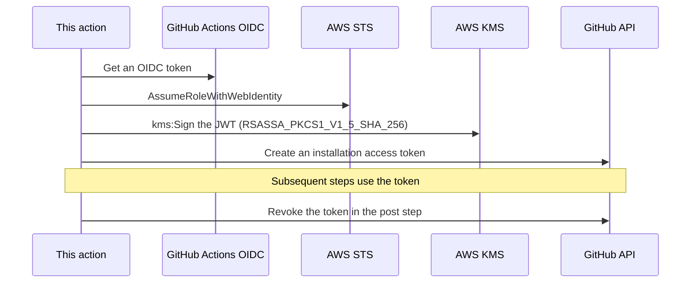

# aws-kms-github-app-token-action [](https://github.com/int128/aws-kms-github-app-token-action/actions/workflows/ts.yaml)

This action creates a GitHub App installation access token with a private key stored in AWS KMS.
It is a drop-in replacement for [actions/create-github-app-token](https://github.com/actions/create-github-app-token).
The private key never leaves AWS KMS.

## Why

A private key on the runner can leak to any step in the workflow.
This action keeps the private key in AWS KMS and only requests signatures.

|                                | actions/create-github-app-token                     | This action                                                                                                 |
| ------------------------------ | --------------------------------------------------- | ----------------------------------------------------------------------------------------------------------- |
| Private key on the runner      | Exposed. Any step or third-party action can read it | Never exposed                                                                                               |
| Audit of the private key usage | Not traceable to a workflow                         | CloudTrail records `AssumeRoleWithWebIdentity` and `kms:Sign`                                               |
| AWS credentials on the runner  | Not applicable                                      | Kept in the action memory. Not exported to subsequent steps, unlike `aws-actions/configure-aws-credentials` |

## Getting Started

Set up AWS KMS, an IAM role and a workflow in this order.

### Import the private key into AWS KMS

GitHub generates the private key of a GitHub App, so you need to import it into AWS KMS as external key material.

1. Create a KMS key with `KeySpec=RSA_2048`, `KeyUsage=SIGN_VERIFY` and `Origin=EXTERNAL`.
2. Generate a private key in the GitHub App settings.
3. Convert the private key from PEM to PKCS#8 DER, because AWS KMS requires the DER format.
   ```sh
   openssl pkcs8 -topk8 -inform PEM -outform DER -nocrypt -in private-key.pem -out private-key.der
   ```
4. Import the private key into the KMS key.
   See [Importing key material](https://docs.aws.amazon.com/kms/latest/developerguide/importing-keys.html).
5. Delete the private key from your computer.

To rotate the private key without downtime, follow these steps.
A GitHub App accepts multiple private keys at the same time.

1. Generate a new private key in the GitHub App settings.
2. Import the new private key into a new KMS key.
3. Switch the alias to the new KMS key.
4. Delete the old private key in the GitHub App settings.
5. Schedule the deletion of the old KMS key.

### Create an IAM role

The IAM role controls which repositories can use the GitHub App.

Create an IAM role and add the following statement to the trust policy for the GitHub OIDC provider.
Restrict the `sub` claim to the repositories which are allowed to use the GitHub App.

```json
{
  "Effect": "Allow",
  "Principal": {
    "Federated": "arn:aws:iam::123456789012:oidc-provider/token.actions.githubusercontent.com"
  },
  "Action": "sts:AssumeRoleWithWebIdentity",
  "Condition": {
    "StringEquals": {
      "token.actions.githubusercontent.com:aud": "sts.amazonaws.com"
    },
    "StringLike": {
      "token.actions.githubusercontent.com:sub": "repo:your-org/your-repo:*"
    }
  }
}
```

Add the following statement to the permissions policy of the role, to allow it to sign with the KMS key.

```json
{
  "Effect": "Allow",
  "Action": "kms:Sign",
  "Resource": "arn:aws:kms:ap-northeast-1:123456789012:key/...",
  "Condition": {
    "StringEquals": { "kms:SigningAlgorithm": "RSASSA_PKCS1_V1_5_SHA_256" }
  }
}
```

The role can create a token for any installation of the GitHub App with any permission.
If you need to restrict the scope, separate the roles or GitHub Apps by use case.

### Create a workflow

Grant `id-token: write` to the job, because this action requires a GitHub OIDC token.

```yaml
jobs:
  example:
    runs-on: ubuntu-latest
    permissions:
      id-token: write
    steps:
      - uses: int128/aws-kms-github-app-token-action@v0
        id: app-token
        with:
          role-to-assume: arn:aws:iam::123456789012:role/github-app-signer
          aws-region: ap-northeast-1
          kms-key-id: alias/github-app-key
          client-id: ${{ vars.APP_CLIENT_ID }}
          permission-contents: read
      - run: gh repo view "$GITHUB_REPOSITORY"
        env:
          GITHUB_TOKEN: ${{ steps.app-token.outputs.token }}
```

## How it works

This action signs the JWT of the GitHub App with AWS KMS instead of a local private key.



The post step skips the revocation in the following cases.

- `skip-token-revoke` is `true`.
- The token has already expired.

## Specification

The inputs and outputs follow [actions/create-github-app-token](https://github.com/actions/create-github-app-token) and [aws-actions/configure-aws-credentials](https://github.com/aws-actions/configure-aws-credentials).

### Inputs

| Name                | Default                                 | Description                                                                                               |
| ------------------- | --------------------------------------- | --------------------------------------------------------------------------------------------------------- |
| `role-to-assume`    | (required)                              | ARN of the IAM role to assume via GitHub OIDC                                                             |
| `role-session-name` | `<owner>.<repo>@<run_id>`               | Role session name                                                                                         |
| `aws-region`        | (required)                              | AWS region of the KMS key                                                                                 |
| `kms-key-id`        | (required)                              | ID, ARN or alias of the KMS key                                                                           |
| `client-id`         | (required)                              | GitHub App Client ID                                                                                      |
| `owner`             | current repository owner                | Owner of the GitHub App installation                                                                      |
| `repositories`      | current repository, if `owner` is unset | Newline-separated list of repositories to grant the token access to. Each entry is `repo` or `owner/repo` |
| `skip-token-revoke` | `false`                                 | If true, the post step does not revoke the token                                                          |
| `permission-*`      | all permissions of the app              | Level of permission to grant the token. See [action.yaml](action.yaml) for the list                       |

The token scope depends on the combination of `owner` and `repositories`.

| `owner` | `repositories` | Token scope                                         |
| ------- | -------------- | --------------------------------------------------- |
| unset   | unset          | Current repository                                  |
| unset   | set            | Listed repositories of the current repository owner |
| set     | unset          | All repositories of the installation for the owner  |
| set     | set            | Listed repositories of the owner                    |

### Outputs

| Name              | Description                      |
| ----------------- | -------------------------------- |
| `token`           | GitHub installation access token |
| `installation-id` | GitHub App installation ID       |
| `app-slug`        | GitHub App slug                  |
